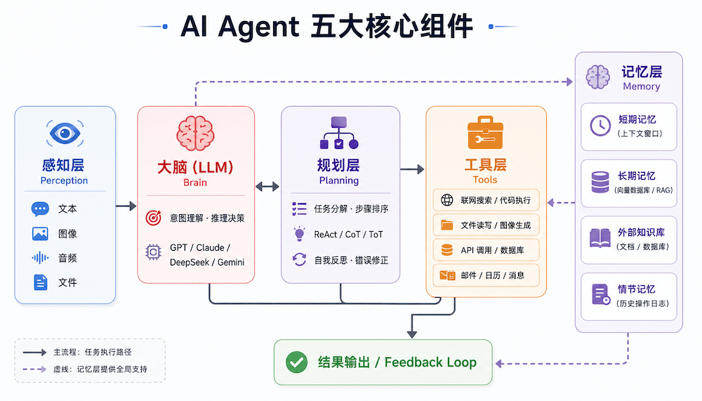
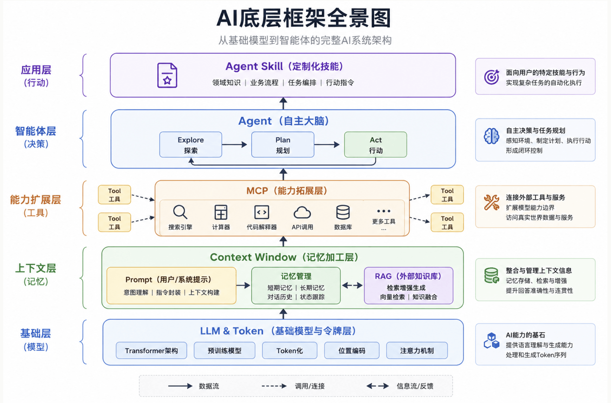

# AI Agent
- AI Agent（Artificial Intelligence Agent） 称为智能体
- 本质是自动执行任务的程序，核心在于让模型不只回答问题，而是按步骤完成动作。
- Agent = LLM (大脑) + Planning (规划) + Tool use (执行) + Memory (记忆)
- 工作流程：输入 → 思考 → 调用工具 → 执行 → 返回结果 → 持续迭代
- AI Agent = 大语言模型的理解与推理能力 + 记忆与状态管理 + 工具调用 + 规划执行 + 反馈修正 + 权限治理
- LLM 主要负责理解和生成；Agent 还需要记忆、工具、规划、状态管理、权限控制和结果验证等组件。

# 核心组件

# 多 Agent 架构
将不同职责拆分给多个 Agent：

协调 Agent
├── 数据 Agent
├── 风险 Agent
├── 财务 Agent
├── 文档 Agent
└── 审批 Agent

# 实现技术
## Prompt Engineering
通过系统提示词约束 Agent 的角色、目标和行为

一个较完整的提示词通常定义：
- 角色；
- 任务；
- 可用工具；
- 工具使用条件；
- 输出格式；
- 不允许执行的操作；
- 遇到不确定性时的处理方式；
- 何时请求人工确认。

## Function Calling / Tool Calling
模型通过结构化格式请求调用工具

## RAG：检索增强生成
RAG（Retrieval-Augmented Generation）让模型在回答前检索企业知识。

## 记忆技术
### 对话窗口记忆
直接把最近消息放入上下文。

优点：简单。
缺点：上下文会变长，成本和延迟上升。

### 摘要记忆
- 定期将历史对话压缩成摘要。
- 摘要记忆把较长的对话、文档或任务历史压缩成一段较短的自然语言摘要

适合保存的内容
- 长对话的整体背景；
- 项目进展；
- 已经做过的分析；
- 用户当前目标；
- 尚未解决的问题；
- 重要讨论结论。

优点：节省上下文。
缺点：摘要可能丢失细节。

### 事实记忆
- 事实记忆保存的是经过提取和结构化的具体信息，通常表现为字段、键值对或数据库记录。

适合保存的内容
- 用户明确表达的语言偏好；
- 常用工作格式；
- 已确认的业务参数；
- 客户或项目的稳定属性；
- 任务中的关键状态；
- 经人工确认的规则或结论。

优点：便于查询。
缺点：需要解决事实更新和冲突。

### 任务状态记忆
记录任务进度，对长流程自动化尤其重要。

## 规划与推理技术
- ReAct，在“思考”和“行动”之间循环
- Plan-and-Execute，先制定完整计划，再逐步执行
- Reflection，执行后自我检查
- Tree of Thoughts，针对多个候选方案进行探索和比较

manage-future-dated-payments-journey