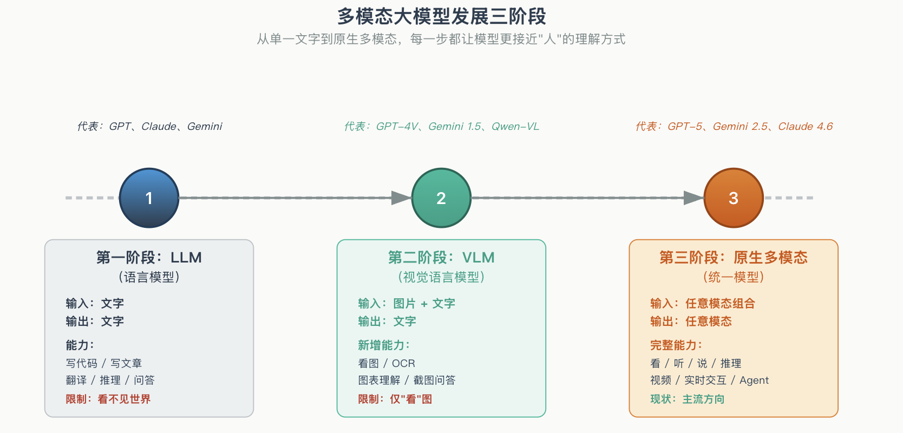
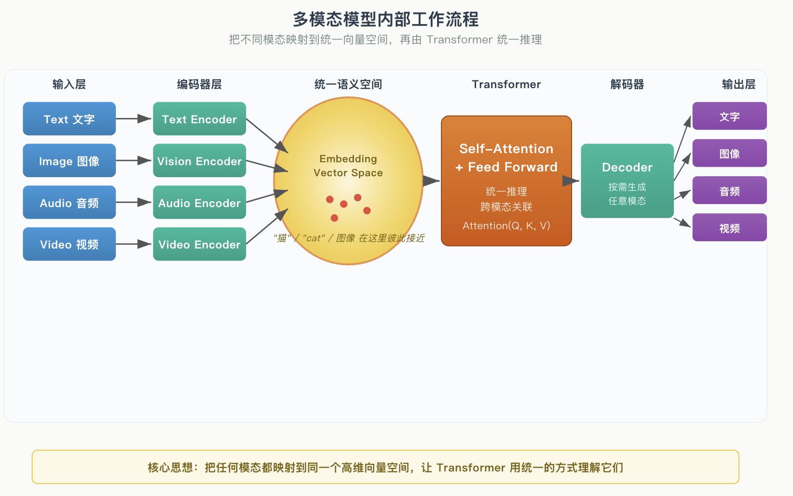
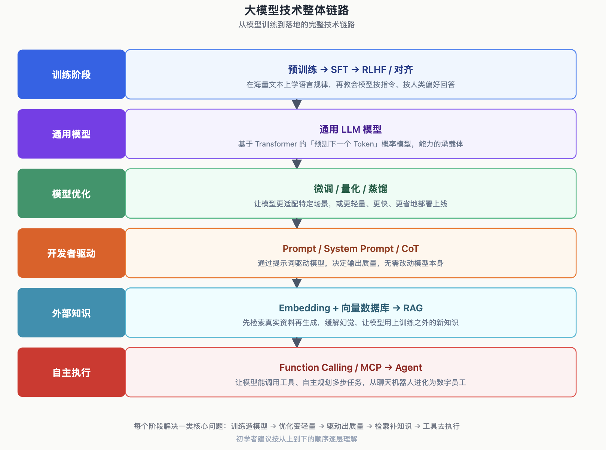

# 大模型
- 模态（Modality）, 信息的表现形式
- 多模态, 让 AI 同时处理文本、图像、音频、视频等多种信息形式
- Token (词元) = AI 能理解的最小文本单位. 常见词是一个 Token，复杂词会被拆开，标点也算 Token。

# 多模态大模型的发展过程

# 整体技术链路

- 训练阶段：让他学习大量知识和语言规律；
- 通用模型：他具备基本的理解和表达能力；
- 模型优化：让他更快、更省资源地工作；
- 开发者驱动：通过明确指令告诉他怎样完成任务；
- 外部知识：给他配备企业资料库；
- 自主执行：让他能够使用工具、处理流程和完成工作。

核心术语速查表

|  术语 |  英文 / 全称 |  所属环节 |  一句话解析 |  
|  -- |  -- |  -- |  -- |  
|  LLM |  Large Language Model（大语言模型） |  基础概念 |  基于海量文本训练的深度学习模型，本质是「预测下一个词」 |  
|  Transformer |  Transformer |  基础概念 |  几乎所有现代 LLM 共用的底层网络架构 |  
|  注意力机制 |  Attention / Self-Attention |  基础概念 |  让模型动态关注输入中相关的词，从而理解上下文关系 |  
|  Token |  Token（词元） |  基础概念 |  模型处理文本的最小单位；上下文长度与 API 计费都按它算 |  
|  上下文窗口 |  Context Window |  基础概念 |  模型一次能「看到」和处理的最大 Token 数 |  
|  参数量 |  Parameters |  基础概念 |  模型内部可学习的权重数量，常以 B（十亿）为单位 |  
|  预训练 |  Pre-training |  训练 |  在海量无标注文本上学语言规律，奠定能力基础 |  
|  SFT |  Supervised Fine-Tuning（监督微调） |  训练 |  用问答对数据教模型按指令回答问题 |  
|  RLHF |  Reinforcement Learning from Human Feedback |  训练 |  用人类打分校准模型输出，使其更符合人类偏好 |  
|  RLAIF |  Reinforcement Learning from AI Feedback |  训练 |  用 AI 代替人类打分，降低标注成本 |  
|  对齐 |  Alignment |  训练 |  让模型行为符合人类意图，做到有用、诚实、安全 |  
|  微调 |  Fine-tuning |  训练 |  在通用模型上用领域数据继续训练，适配专业场景 |  
|  MoE |  Mixture of Experts（混合专家模型） |  训练 |  多个专家子网络按需激活，参数大而推理快 |  
|  Prompt |  Prompt（提示词） |  使用 |  输入给模型的指令或问题，直接决定输出质量 |  
|  提示词工程 |  Prompt Engineering |  使用 |  研究如何写出更清晰、更有效 Prompt 的技巧 |  
|  System Prompt |  System Prompt（系统提示词） |  使用 |  预先设定模型角色与行为规范的指令 |  
|  温度 |  Temperature |  使用 |  控制输出随机性的参数，取值 0~2，越大越发散 |  
|  上下文学习 |  In-Context Learning |  使用 |  在 Prompt 里给几个示例就照做，又称 Few-shot |  
|  思维链 |  Chain-of-Thought（CoT） |  使用 |  引导模型分步推理再给答案，提升复杂任务准确率 |  
|  幻觉 |  Hallucination |  使用 |  模型生成流畅但错误或凭空编造的内容 |  
|  Embedding |  Embedding（嵌入） |  外部世界 |  把内容转换成向量，用于衡量语义相似度 |  
|  向量数据库 |  Vector Database |  外部世界 |  专门存储与检索向量的数据库，如 Milvus、Chroma |  
|  RAG |  Retrieval-Augmented Generation（检索增强生成） |  外部世界 |  先检索真实资料再生成，缓解幻觉、补充新知识 |  
|  Function Calling |  Function Calling（函数调用） |  外部世界 |  让模型调用外部工具或 API 执行实际动作 |  
|  MCP |  Model Context Protocol（模型上下文协议） |  外部世界 |  标准化连接工具的开放协议，AI 的「USB 接口」 |  
|  Agent |  Agent（智能体） |  外部世界 |  能自主规划、调用工具、多步执行复杂任务的系统 |  
|  ReAct |  Reason + Act |  外部世界 |  Agent 的核心循环：思考—行动—观察—再思考 |  
|  多模态 |  Multimodal |  外部世界 |  同时理解和/或生成文本、图像、音频等多种数据 |  
|  量化 |  Quantization |  优化 |  压缩参数精度（32 位→8/4 位），省显存、提速度 |  
|  模型蒸馏 |  Model Distillation |  优化 |  用大模型教小模型，得到更小更快的部署模型 | 

| AI 技术环节 | 员工培养类比 |
|---|---|
| 预训练 | 读大量书、接受通识教育 |
| SFT | 跟老师学习标准做法 |
| RLHF / 对齐 | 接受反馈，学会符合公司的期望 |
| 通用 LLM | 具备综合能力的员工 |
| 微调 | 接受某个专业领域培训 |
| 量化 | 学会用更少资源高效工作 |
| 蒸馏 | 把专家经验教给初级员工 |
| Prompt | 交代具体任务 |
| System Prompt | 公司制度和岗位规范 |
| CoT | 按步骤分析复杂问题 |
| Embedding | 把知识按含义分类 |
| 向量数据库 | 企业知识库 |
| RAG | 先查资料再回答 |
| Function Calling | 工具少时，直接使用 |
| MCP | 工具多时，统一的工具连接方式 |
| Agent | 能规划、查资料、用工具并完成工作的数字员工 |

## 训练阶段：预训练 → SFT → RLHF / 对齐

SFT
- SFT 是 Supervised Fine-Tuning，中文通常称为：监督微调
- 监督微调使用人工准备的“问题—答案”示例训练模型

RLHF
- RLHF 是 Reinforcement Learning from Human Feedback，中文通常称为：基于人类反馈的强化学习
- 让模型更符合人的偏好
- 在 RLHF 中，人类会对不同答案进行比较和排序，模型再学习这些偏好

对齐
- 让模型的行为符合目标
- 让模型的目标、行为和输出符合人类需求、业务规则和安全要求。

## 通用模型：LLM
- LLM 是 Large Language Model，中文是：大语言模型

1. 什么是语言模型？
- 语言模型的任务是预测：
- 在当前上下文之后，最可能出现什么内容？

2. 什么是 Token？
- Token 可以理解为模型处理文字时使用的“基本单位”。
- 它不一定等于一个汉字或一个英文单词
- 一个汉字可能是一个 Token；
- 一个英文单词可能被拆成多个 Token；
- 标点符号也可能是 Token；
- 一段代码会被拆成许多 Token。

3. 什么是 Transformer？
- Transformer 是一种深度学习网络架构，也是现代大语言模型的主要基础。
- 它最重要的能力是：能够关注一句话中不同词语之间的关系。
- Transformer 的注意力机制就像一种自动“划重点”的方法。

Transformer 中的“注意力机制”可以帮助模型判断：
- 哪些词彼此相关；
- 哪些内容更重要；
- 当前词应该参考前面哪些词；
- 长距离上下文之间有什么联系。

通俗比喻，读一段话时，人不会平均关注每个字，而会重点看：
- 主语；
- 关键动词；
- 时间；
- 条件；
- 转折；
- 数字；
- 专有名词。

## 模型优化：微调、量化、蒸馏
- 让模型更适合特定业务，并且更快、更便宜、更容易部署
- 让通用模型学会特定业务

**微调、量化、蒸馏的区别**
| 技术 | 主要改变 | 主要收益 |
|---|---|---|
| 微调 | 模型的专业能力和行为 | 更适合特定任务 |
| 量化 | 数值精度和模型体积 | 更省资源、更快 |
| 蒸馏 | 用大模型能力训练小模型 | 小模型接近大模型效果 |

1. 微调：让通用模型学会特定业务

| 模型 |  类比 |  
| -- |  -- |  
| 通用模型 |  受过全面教育的毕业生 |  
| 微调模型 |  接受了金融、法律或技术专项培训的专业人员 |  

2. 量化：减少模型占用的资源, **在“效果”和“成本”之间做平衡**
- 降低显存和内存占用；
- 提高推理速度；
- 降低部署成本；
- 让模型能够运行在更普通的硬件上。

3. 蒸馏：让小模型学习大模型
蒸馏是让一个较小的“学生模型”学习较大的“教师模型”。

通俗比喻
- 一个经验丰富的专家带着新人工作。专家不把所有思考过程都完整交给新人，而是通过大量示范让新人掌握：
    - 处理方式；
    - 判断模式；
    - 常见答案；
    - 解决问题的路径。
- 最后，新人虽然没有专家那么强，但更轻便、更快、更便宜。

蒸馏适合什么场景？
- 高频、简单、重复的任务；
- 低延迟场景；
- 终端设备部署；
- 成本敏感的场景；
- 对模型规模有限制的场景。

## 开发者驱动：Prompt、System Prompt、CoT
- 不改变模型本身，通过指令让它完成具体任务

1. Prompt：给模型的任务说明
- 给模型的输入指令。

2. **Prompt 与 System Prompt 的区别**
| 类型 | 作用 | 类比 |
|---|---| -- |
| Prompt | 当前任务的具体要求 | 今天交办的具体任务 |
| System Prompt | 系统长期遵循的行为规则 | 公司的工作制度 |

3. CoT
- CoT 是 Chain-of-Thought，中文常译为：思维链
- 分步骤处理复杂问题
- 它指的是让模型在处理复杂任务时，按照中间步骤进行推理，而不是直接跳到结论。
    - 识别已知条件；
    - 判断问题类型；
    - 分解子问题；
    - 分别计算或分析；
    - 检查结果；
    - 得出结论。

## 外部知识：Embedding + 向量数据库 → RAG    
- 模型本身不知道企业内部资料，怎样让它查到并使用这些资料

1. 为什么需要外部知识？
- 通用模型虽然知识广泛，但通常不知道企业相关知识
- 如果直接问模型，它可能会根据一般经验猜测，这就容易产生幻觉。

2. Embedding：把文字转换成“意义坐标”
- 把一段文字转换成一组数字，这组数字代表它的语义特征。
- 它不只是看关键词，而是试图判断内容的含义是否相近

3. 向量数据库：按语义查资料

4. RAG：先检索，再生成
- RAG 是 Retrieval-Augmented Generation，中文通常称为：检索增强生成

## 自主执行：Function Calling / MCP → Agent
- 怎样让模型不仅回答问题，还能调用工具、完成任务

1. Function Calling：让模型调用函数或工具
- 模型不直接执行操作，而是以结构化方式请求系统调用某个函数。

为什么不能让模型直接操作？
- 因为模型本身只是生成文本，不能天然保证：
    - 参数正确；
    - 用户有权限；
    - 操作范围合理；
    - 数据不会泄露；
    - 高风险动作不会被误执行。

2. 查询型工具和执行型工具

查询型工具
- 查询数据库；
- 搜索文档；
- 查询汇率；
- 查询订单状态；
- 查询日历。

执行型工具
- 发送邮件；
- 修改客户信息；
- 创建审批申请；
- 提交交易；
- 执行付款；
- 删除文件。
- 这类操作风险更高，通常需要：
    - 人工确认；
    - 审批；
    - 金额限制；
    - 双人复核；
    - 可回滚；
    - 完整审计记录。    

3. MCP：统一模型与工具之间的连接方式    
- MCP 是 **Model Context Protocol**，中文可译为：**模型上下文协议**
- 它的目标是为模型连接外部工具、数据和上下文提供一种更统一的方式。
- 通俗比喻: 如果每个电器都使用完全不同的插头，使用起来很麻烦。**统一插座标准后**，电器更容易连接。

MCP 类似于模型工具连接中的一种“通用接口规范”，可以帮助模型接入：
- 文件；
- 数据库；
- 搜索系统；
- 企业 API；
- 开发工具；
- 业务服务。

MCP 与 Function Calling 的关系
- MCP 可以把工具标准化地提供给应用，再由应用通过 Function Calling 让模型决定何时调用
- **Function Calling，工具规模小，直接调用；MCP，工具规模大了，定义了一套统一的接口**

直接使用 Function Calling：
- 工具数量较少；
- 工具由同一个应用团队维护；
- 只服务于一个应用；
- 希望快速完成模型与内部函数的集成。

引入 MCP：
- 需要连接多个外部工具或数据源；
- 希望工具可以被多个 AI 客户端复用；
- 希望工具提供方与模型应用解耦；
- 需要统一工具发现、权限控制、审计和生命周期管理。

4. Agent：从聊天机器人到数字员工

Agent 通常包含：
- 任务理解；
- 规划；
- 记忆；
- 工具调用；
- 结果观察；
- 错误处理；
- 状态管理；
- 权限控制；
- 必要时请求人工介入。