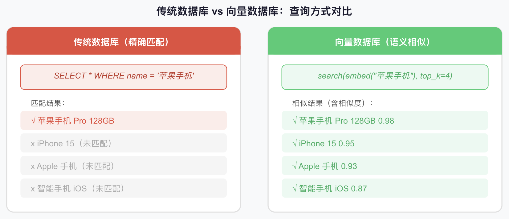
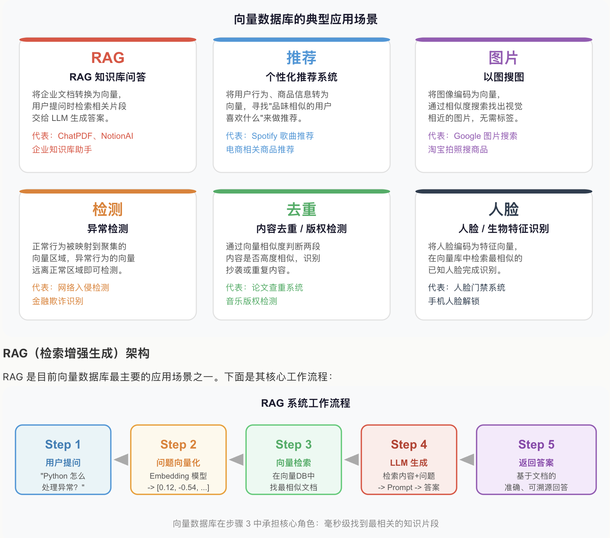
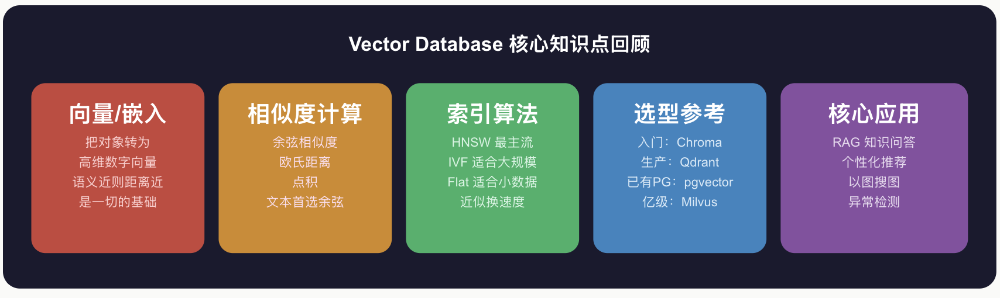
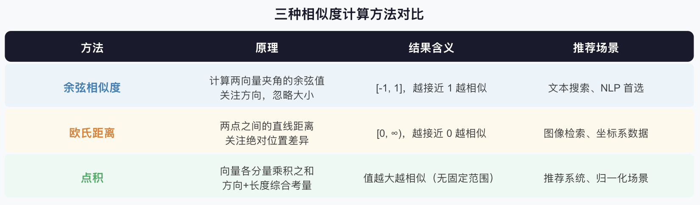
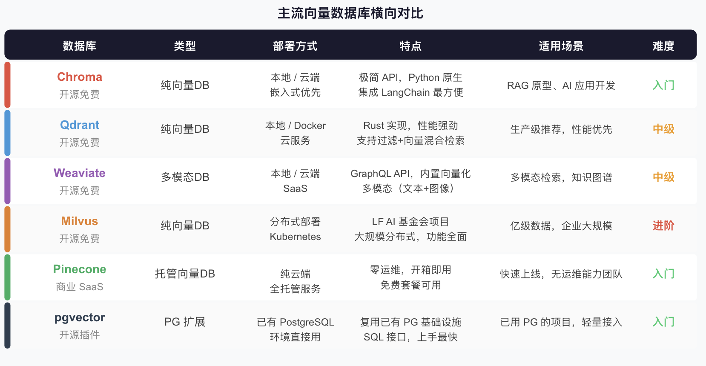

# 向量数据库（Vector Database）
- 是一种专门用于存储、索引和检索高维向量数据的数据库系统
- 嵌入（Embedding）
    - 是将现实世界的对象（文字、图片、音频等）转换成向量的过程和结果
    - 这个转换由嵌入模型完成，其核心思想是：语义相近的对象，其向量在空间中的距离也更近

# 相似度计算方法
- 余弦相似度（Cosine Similarity）
- 欧氏距离（Euclidean Distance）
- 点积（Dot Product）

# 向量索引算法
| 索引类型 | 特点 | 适用场景 |
| -- | -- | -- |
| Flat（暴力） | 精确但慢 | 小数据集、精度优先 |
| IVF_Flat | 聚类后精确搜索，速度快 | 中大规模，内存充足 |
| IVF_PQ | 量化压缩，节省内存 | 超大规模，内存受限 |
| HNSW | 速度快、精度高，内存占用高 | 最常用，推荐首选 |
| ScaNN | Google 出品，优化吞吐量 | 高并发生产环境 |

# 主流向量数据库对比
