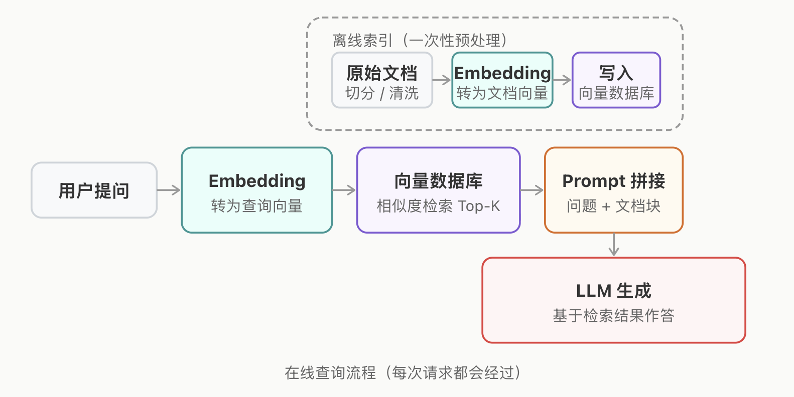

# RAG 与知识检索
- RAG（Retrieval-Augmented Generation，检索增强生成）
- 核心思想是：让 LLM 在回答问题时，先从外部知识库中检索相关内容，再基于检索结果生成回答，而不是仅依赖模型训练时记住的知识。
- 解决了 LLM 的两个核心痛点：知识截止日期（模型不知道训练后发生的事）和幻觉问题（模型在不确定时会编造答案）

# RAG 基础原理
由两条流水线组成：离线索引流水线（将文档预处理存入向量库）和在线查询流水线（接收用户问题、检索、生成）

# 技术与数据库选型建议
| 数据库/工具选型 | 类型 | 推荐落地场景 |
| -- | -- | -- |
| Pinecone / Zilliz Cloud | 全托管云服务 | 开箱即用，不想维护基础设施。搭配 Cohere Rerank + GPT-4o 是最快商用的方案。 |
| Qdrant | 开源 + 托管 | Rust 编写，内存管理优秀，性能极高。适合企业级私有化部署。 |
| Weaviate / Elasticsearch | 开源 + 托管 | 自带极其成熟的 BM25 + 向量混合检索（Hybrid Search），专有名词较多的场景首选。 |
| Milvus | 开源分布式 | 适合十亿至百亿级别的超大规模企业级检索平台。 |
| Chroma / FAISS | 本地库/嵌入式 | 极轻量，无需部署独立服务。非常适合本地开发、个人知识库项目验证。 |

# RAG 评估指标（RAGAS 框架）
- Context Recall（检索召回率）：标准答案中的信息有多少比例能被检索到。
- Context Precision（检索精确率）：检索到的文档中有多少比例是真正相关的。
- Faithfulness（忠实度/幻觉指标）：生成的答案是否都有检索出的文档支撑。
- Answer Relevance（答案相关性）：生成的答案是否真正回答了用户的问题，避免答非所问。